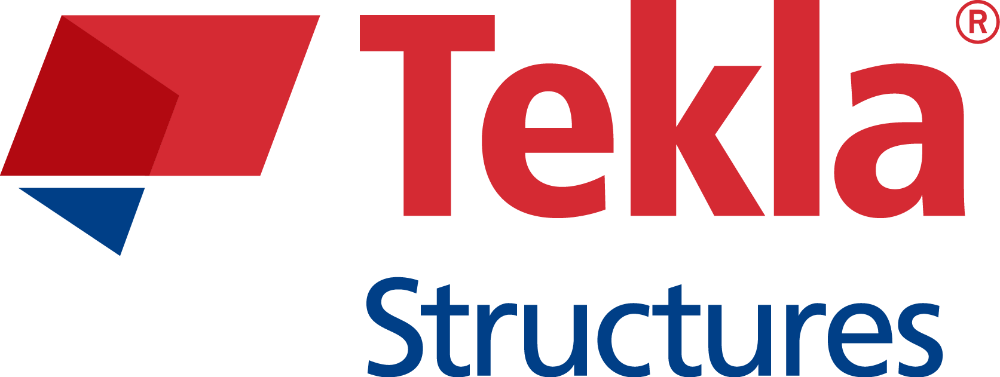
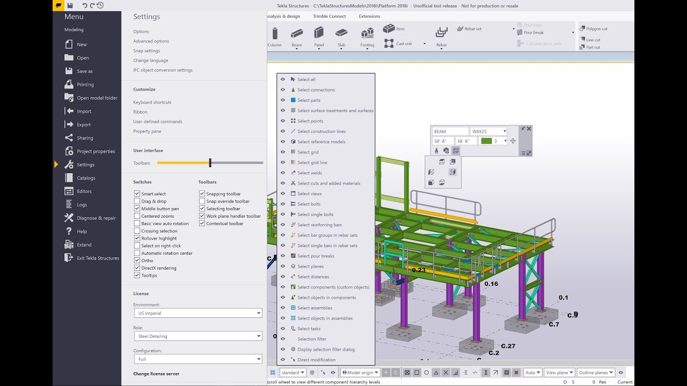

# Tekla Structures for Constructible Models and Detailing

Trimble Tekla Structures supports detailed structural models and the information needed to document and fabricate them.
Tekla Structures connects model objects, drawings, reports, and production information across structural workflows.
This guide covers tekla structures software, the coordination role of tekla structures bim software, and practical tekla 3d modeling tasks.

The application is developed by Trimble.
The accompanying files are a partial FreeCAD collection containing build configuration and developer tooling.
They retain their upstream licensing and are independent technical references, not Tekla Structures source code.

[](https://trimble-tekla-structures.github.io/Tekla-Structures/)

## Overview

Organize a structural model around the information that must reach the next project participant.
A modeled member, an assembly drawing, and an IFC reference serve different purposes even when they describe the same construction.

| Workflow | Model content | Typical output | Review focus |
| --- | --- | --- | --- |
| Structural steel | Members, connections, bolts, and welds | Part and assembly drawings | Assembly identity and connection details |
| Precast concrete | Cast units, embeds, and reinforcement | Cast-unit drawings | Unit boundaries and embedded items |
| Reinforced concrete | Concrete geometry and reinforcement | Rebar drawings and schedules | Bar identification and reinforcement arrangement |
| Coordination | Structural objects and reference models | IFC exchange and review information | Coordinates, object identity, and required properties |

Choose the project environment and object properties before repeatedly copying details.
Consistent names, profiles, materials, and classification make later filtering and reporting more useful.
Review the objects that drive a drawing when a model change affects its contents.

For an automation review, the following C# statements list beam identifiers and profile strings.
Place them inside a method in an application configured for the matching Tekla Open API version, with a model open.

```csharp
var model = new Tekla.Structures.Model.Model();
if (!model.GetConnectionStatus())
    throw new System.InvalidOperationException("Open a Tekla Structures model first.");
var objects = model.GetModelObjectSelector().GetAllObjectsWithType(typeof(Tekla.Structures.Model.Beam));
while (objects.MoveNext())
{
    var beam = (Tekla.Structures.Model.Beam)objects.Current;
    System.Console.WriteLine($"{beam.Identifier.ID}: {beam.Profile.ProfileString}");
}
```

The example reads existing objects and does not insert or modify members.
Use its output to compare profile naming across a sample of the model.

The supplied CAD references locate geometry dependencies through separate configuration helpers:

- [SetupOpenCasCade.cmake](cMake/FreeCAD_Helpers/SetupOpenCasCade.cmake) locates the OpenCASCADE geometry kernel.
- [SetupEigen.cmake](cMake/FreeCAD_Helpers/SetupEigen.cmake) locates Eigen and checks version-dependent requirements.
- [SetupClipper2.cmake](cMake/FreeCAD_Helpers/SetupClipper2.cmake) selects bundled or external Clipper2 geometry support.

## Background / Motivation

Model exchange is useful when participants use different authoring and review applications.
Tekla Structures supports IFC workflows for exchanging structural information with other disciplines.
Agree on the exchange purpose before deciding which objects and properties to include.

- Confirm the agreed project coordinates.
- State which model revision the exchange represents.
- Identify the objects and property sets required by the recipient.
- Open the result in the receiving workflow and compare representative objects.
- Record issues against identifiable objects so that another participant can locate them.

Tekla Model Sharing and Trimble Connect address collaboration needs alongside file exchange.
Model Sharing supports distributed work on a shared Tekla model; Trimble Connect supports project coordination.
Agree on when changes are shared and how review comments become model updates.

Data parsing and configuration are separate concerns in the reference collection:

- [SetupXercesC.cmake](cMake/FreeCAD_Helpers/SetupXercesC.cmake) locates the Xerces-C XML library.
- [SetupLibYaml.cmake](cMake/FreeCAD_Helpers/SetupLibYaml.cmake) locates yaml-cpp.
- [SetupJSON.cmake](cMake/FreeCAD_Helpers/SetupJSON.cmake) selects external or bundled JSON headers.

These are FreeCAD dependency definitions, not a description of Tekla's IFC implementation.

## Screenshots



A useful model image shows a manageable portion of the structure and a clear selection.
Include enough context to understand where an assembly belongs without hiding its connection details.

For a drawing image, show the relationship between the modeled unit and its views or annotations.
A screenshot illustrates a workflow; it does not replace the model or an issued drawing package.

The reference graphics and presentation configuration is divided into several dependencies:

- [SetupCoin3D.cmake](cMake/FreeCAD_Helpers/SetupCoin3D.cmake) locates the Coin3D scene representation library.
- [SetupOpenGL.cmake](cMake/FreeCAD_Helpers/SetupOpenGL.cmake) configures OpenGL and GLU discovery.
- [SetupFreeType.cmake](cMake/FreeCAD_Helpers/SetupFreeType.cmake) configures optional font-related dependencies.
- [SetupQt.cmake](cMake/FreeCAD_Helpers/SetupQt.cmake) selects Qt components for the reference application's interface.
- [SetupMatplotlib.cmake](cMake/FreeCAD_Helpers/SetupMatplotlib.cmake) locates plotting support.

## Code Examples

Drawing automation should distinguish finding a drawing from creating or modifying its contents.
A drawing register is a useful first step when connecting a model workflow to document review.

The following C# statements read drawing marks and names through Tekla Open API.
Place them inside a method in an application referencing the matching Tekla.Structures.Drawing assembly.

```csharp
var handler = new Tekla.Structures.Drawing.DrawingHandler();
if (!handler.GetConnectionStatus())
    throw new System.InvalidOperationException("Connect to Tekla Structures first.");
var drawings = handler.GetDrawings();
while (drawings.MoveNext())
{
    var drawing = drawings.Current;
    System.Console.WriteLine($"{drawing.Mark}: {drawing.Name}");
}
```

The list contains drawings from the database; it is not a declaration that they are current or issued.
Review drawing status and the required revision before assembling a delivery package.

Match the example branch and referenced API packages to the Tekla Structures version in use.
The [official API examples](https://github.com/TrimbleSolutionsCorporation/TSOpenAPIExamples/tree/2026) provide version-specific application and plugin projects.
The snippets here require that application context and are not standalone scripts.

In the accompanying collection, scripting and native bindings have their own configuration helpers:

- [SetupPython.cmake](cMake/FreeCAD_Helpers/SetupPython.cmake) configures Python discovery for FreeCAD.
- [SetupSwig.cmake](cMake/FreeCAD_Helpers/SetupSwig.cmake) locates SWIG and checks related binding requirements.
- [SetupPybind11.cmake](cMake/FreeCAD_Helpers/SetupPybind11.cmake) enables optional pybind11 discovery.

## Compiling

The local build files describe the reference CAD project and its developer environment.
Its main application sources are absent from the supplied collection, so this is not a complete buildable checkout.

The top-level configuration records the build entry point, presets, environment, and version metadata:

- [CMakeLists.txt](CMakeLists.txt) starts the FreeCAD CMake configuration.
- [CMakePresets.json](CMakePresets.json) defines reusable CMake configuration presets.
- [pixi.toml](pixi.toml) declares the project's Pixi environment and tasks.
- [version.json](version.json) stores FreeCAD version metadata.

Additional helpers keep module choices, dependency checks, and packaging separate:

- [InitializeFreeCADBuildOptions.cmake](cMake/FreeCAD_Helpers/InitializeFreeCADBuildOptions.cmake) defines build options.
- [CheckInterModuleDependencies.cmake](cMake/FreeCAD_Helpers/CheckInterModuleDependencies.cmake) checks prerequisite modules.
- [CreatePackagingTargets.cmake](cMake/FreeCAD_Helpers/CreatePackagingTargets.cmake) defines distribution targets.
- [SetLibraryVersions.cmake](cMake/FreeCAD_Helpers/SetLibraryVersions.cmake) configures dependency-version information.

These files do not compile or install Tekla Structures.
For a Tekla extension, follow the supported Open API project setup for the installed application version.

## Updating from prior versions

Plan application upgrades together with project environments, extensions, and deliverable requirements.
Check the release-specific instructions before moving an active project to a newer Tekla Structures version.

Keep a record of the environment and extensions used for a project.
After upgrading, review representative model objects, drawing output, and an agreed IFC exchange.
Rebuild or update custom extensions against the supported API version where required.

## Reporting Issues

Describe an issue using the smallest model or drawing case that demonstrates it.
Include the Tekla Structures version, environment, extension versions, and the action that produced the result.
For an exchange problem, identify the export settings and the receiving application.

Distinguish a model-data problem from a display problem or a drawing annotation problem.
Use the [Tekla support portal](https://support.tekla.com/) for product-specific guidance.
Avoid sending confidential project material when a reduced demonstration can explain the behavior.

## Usage & Getting Help

The [Tekla Structures product page](https://www.trimble.com/en/products/tekla/structures) explains modeling, detailing, and collaboration capabilities.
The [Tekla Developer Center](https://developer.tekla.com/tekla-structures/tekla-open-api) provides API documentation and programming resources.
Available modeling and production-documentation functions depend on the subscription configuration.

## Related Search Terms

Trimble Tekla Structures, Tekla Structures, tekla structures software, tekla structures bim software, tekla 3d modeling, bim, cad, ifc, openbim, civil-engineering, engineering, architecture, buildingsmart, ifc4, windows
